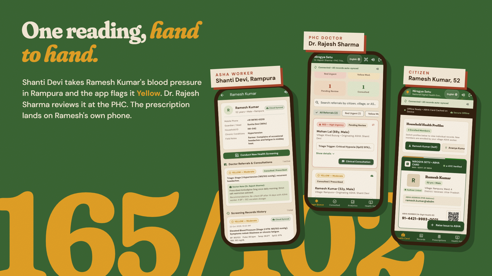
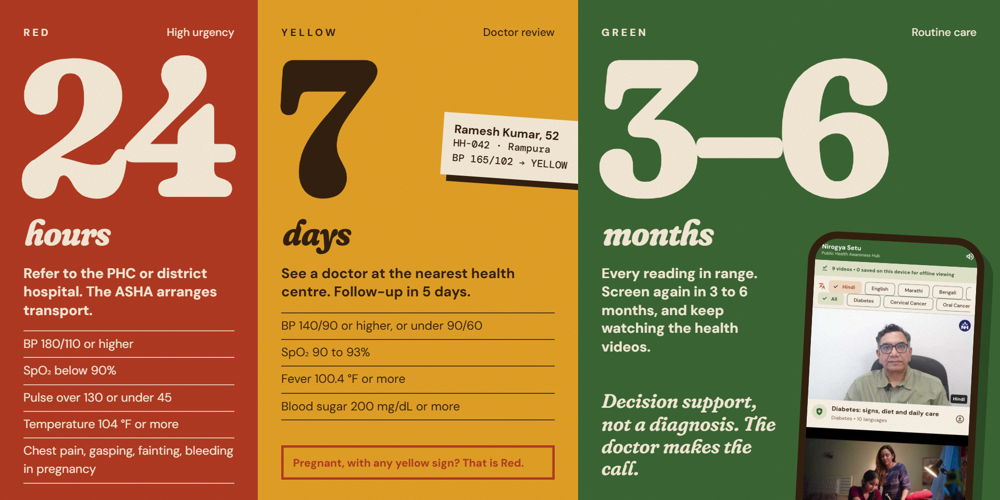
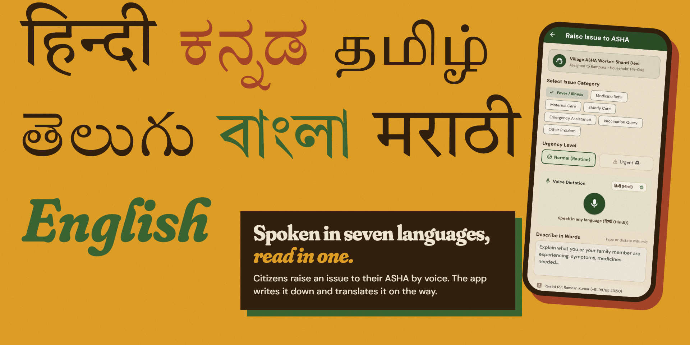

<p align="center"></p>

<h1 align="center">Nirogya Setu · निरोग्य सेतु</h1>

<p align="center"><b>Sehat, ghar ke darwaze tak.</b> Health, to your doorstep.<br>
<a href="https://aarogya-setu-sdg.web.app"><b>Open the live demo →</b></a></p>

*Nirogya* means free of disease. *Setu* means bridge. Nirogya Setu is an offline-first Flutter app that connects three people: the **ASHA worker** who visits the village, the **doctor** at the Primary Health Centre (PHC), and the **family** being cared for. It keeps working with no signal and syncs when the network comes back.

---

## One case, hand to hand



Every screen above is from the live demo, using its sample records:

1. **Shanti Devi**, the ASHA worker for Rampura, screens **Ramesh Kumar** (52, household HH-042). His BP of 165/102 comes out **Yellow**.
2. **Dr. Rajesh Sharma** sees the referral in his PHC triage queue and prescribes Amlodipine 5 mg.
3. Ramesh sees the prescription and his ABHA health card on his own phone, even offline.

## Who uses it

| Role | What they can do |
|---|---|
| **ASHA worker** | Register families and households, screen vitals, get an instant triage colour, refer to the PHC, see open issues on a live village map, scan a citizen's QR card, ask **ASHA Saathi**, the AI clinical assistant |
| **Doctor (PHC medical officer)** | Work a referral queue sorted by urgency, review field vitals and ASHA notes, write diagnosis notes and prescriptions |
| **Citizen** | Show an ABHA card with a QR code, switch between family members on one shared phone, read prescriptions and screening history, raise an issue to their ASHA by voice, call their ASHA |
| **Admin** | Manage ASHA workers, doctors, hospitals and the health video library |

## Triage in three colours



The rules live in [`lib/core/constants/screening_rules.dart`](lib/core/constants/screening_rules.dart):

| Level | When | Any one of |
|---|---|---|
| 🔴 **Red** | Refer to the PHC or district hospital within **24 hours** | BP ≥ 180/110 · SpO₂ < 90% · pulse > 130 or < 45 · temperature ≥ 104 °F · blood sugar ≥ 300 or < 55 mg/dL · chest pain, gasping, fainting, loss of speech, bleeding in pregnancy |
| 🟡 **Yellow** | Doctor review within **7 days**, follow-up in 5 | BP ≥ 140/90 or < 90/60 · SpO₂ 90–93% · pulse > 100 or < 55 · fever ≥ 100.4 °F · blood sugar ≥ 200 or < 70 · cough over 2 weeks, weight loss, swollen legs |
| 🟢 **Green** | Routine screening again in **3–6 months** | All readings in range |

A pregnant woman with any yellow sign is raised to **Red**. The app also rejects impossible entries before saving, such as a diastolic reading higher than the systolic.

> Triage is decision support, not a diagnosis. The doctor makes the call.

## Spoken in seven languages



The app runs in **English, हिन्दी, ಕನ್ನಡ, தமிழ், తెలుగు, বাংলা and मराठी**. Citizens can dictate an issue in their own language; it is translated to English before it reaches the ASHA. Screens can be read aloud for people who find reading hard.

## Built for no signal

- Every citizen, screening, household and referral is saved on the phone first.
- When Wi-Fi or mobile data returns, the sync engine pushes pending records to Cloud Firestore on its own.
- The ABHA card is cached on the device, and health videos can be downloaded to watch offline.

## Tech stack

| Part | Used |
|---|---|
| App | Flutter (Android, web, Windows), Provider |
| Data | Cloud Firestore with role-based security rules, local cache with shared_preferences |
| Auth | Firebase Auth, phone number and password issued by the admin |
| AI assistant and translation | Qwen on Groq |
| Voice | speech_to_text (dictation), flutter_tts (read aloud) |
| Maps and QR | flutter_map + geolocator, qr_flutter + mobile_scanner |
| Hosting | Firebase Hosting |

## Run it

```bash
flutter pub get
flutter run -d chrome     # web
flutter run               # connected Android phone (needs JDK 17)
flutter test
```

Each login screen has a **Quick Bypass** button so evaluators can enter any role without an account.

Deploy the web app:

```bash
flutter build web --release
npx -y firebase-tools@latest deploy --only hosting
```

## Project layout

```
lib/
├── core/        models, services (auth, sync, translation, voice), screening rules, theme
└── features/
    ├── asha_portal/     dashboard, households, screening form, assistant, issue map
    ├── doctor_portal/   triage queue and clinical review
    ├── patient_portal/  ABHA card, records, prescriptions, raise an issue
    ├── admin_portal/    ASHA, doctor, hospital and video management
    ├── awareness_hub/   health videos, offline downloads
    └── auth/ shared/
```

## Team

[@adityabrabb](https://github.com/adityabrabb) · [@Adi140108](https://github.com/Adi140108) · [@kushal287](https://github.com/kushal287) · [@Arman866-bot](https://github.com/Arman866-bot)

## Credits

- Hero background: *A Warli painting by Jivya Soma Mashe, Thane district*, photo by Jean-Pierre Dalbéra, [CC BY 2.0](https://creativecommons.org/licenses/by/2.0/), via Wikimedia Commons (recoloured).
- Brand: Warli mark, Fraunces, DM Sans and Tiro type families (SIL Open Font License).
- People, readings and ID numbers in the screenshots are demo records, not real patients.
